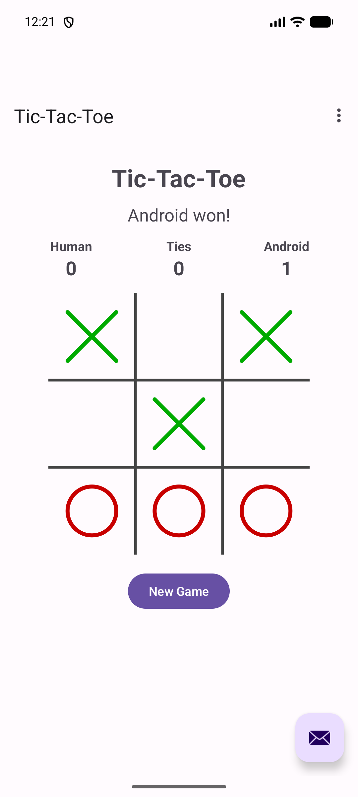
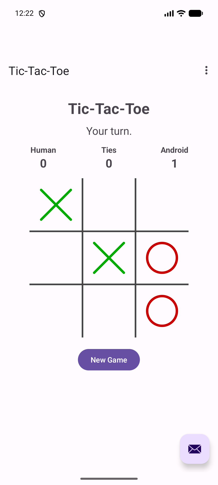
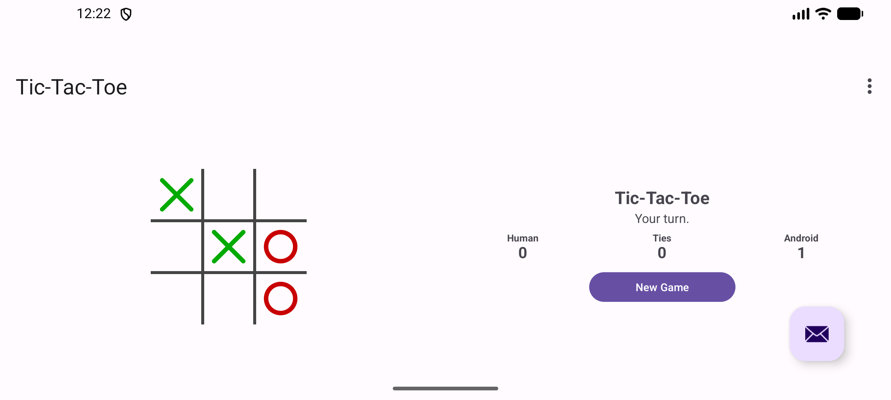
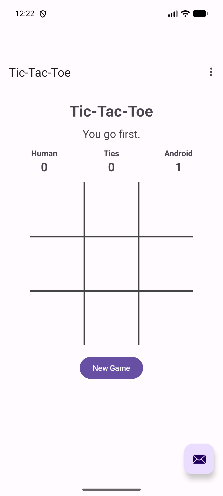
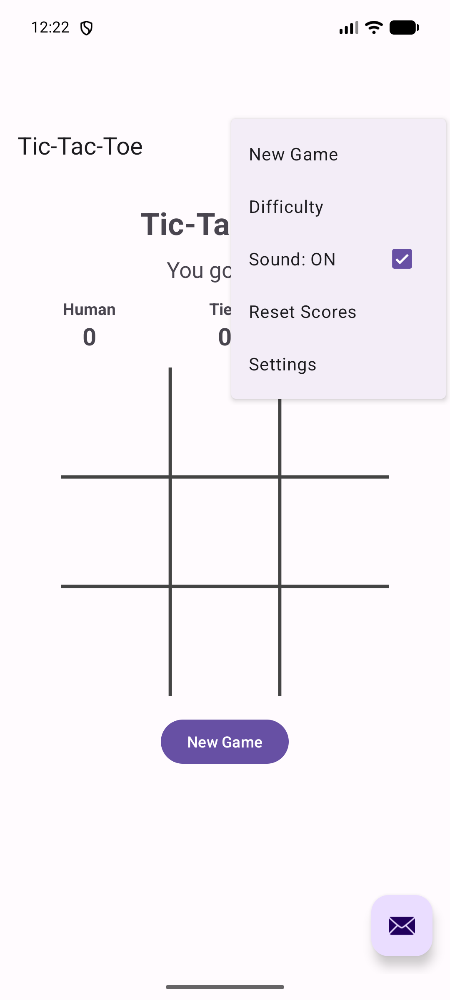

# ❌⭕ Reto 6 – Saving Instance State and Persistent Information

> **Curso:** Desarrollo de Aplicaciones para Dispositivos Móviles · Universidad Nacional de Colombia
> **Autor y desarrollador:** Luis Alberto Castillo Sanabria
> **Plataforma:** Android (Kotlin)

El Triqui ahora **recuerda**. La partida en curso sobrevive a la **rotación de la pantalla** (`onSaveInstanceState`), y el **marcador** y la **dificultad** se guardan de forma permanente con `SharedPreferences`, aunque se cierre la app. También se agrega un **diseño horizontal** propio.

| Marcador | Partida en curso | Pantalla girada: la partida sigue igual |
|:---:|:---:|:---:|
|  |  |  |

| Al reabrir la app el marcador se conserva | Menú con Reset Scores |
|:---:|:---:|
|  |  |

## Funcionalidades

- **Marcador** de victorias del jugador, empates y victorias de Android.
- **Persistencia** del marcador y de la dificultad con `SharedPreferences`.
- **Estado de la partida** (tablero, turno, fin de juego, sonido, dificultad) guardado al rotar con `onSaveInstanceState`.
- Si Android estaba "pensando" al rotar, retoma su jugada después de recrear la pantalla.
- **Diseño horizontal** (`layout-land`): tablero a la izquierda, información a la derecha.
- Opción **Reset Scores** para poner el marcador en cero.
- Se mantienen el tablero con Canvas, el sonido y los tres niveles de dificultad del Reto 5.

## Documentación

📘 **[Manual de usuario y técnico](docs/MANUAL.md)**

## Tecnologías

Kotlin · `SharedPreferences` · `onSaveInstanceState` / `Bundle` · Recursos alternativos `layout-land` · Canvas · `MediaPlayer` · minSdk 24

## Cómo ejecutarlo

1. `git clone https://github.com/LCastillo9806/AndroidTicTacToe-Reto6.git`
2. Abrir en **Android Studio** y pulsar **Run ▶**.

## Autoría

Desarrollado por **Luis Alberto Castillo Sanabria** ([@LCastillo9806](https://github.com/LCastillo9806)) — Universidad Nacional de Colombia.
