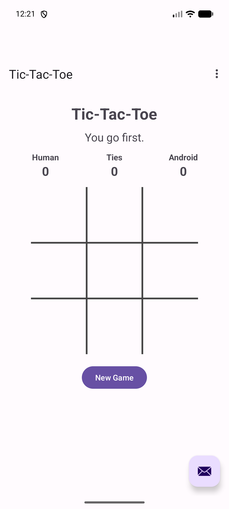
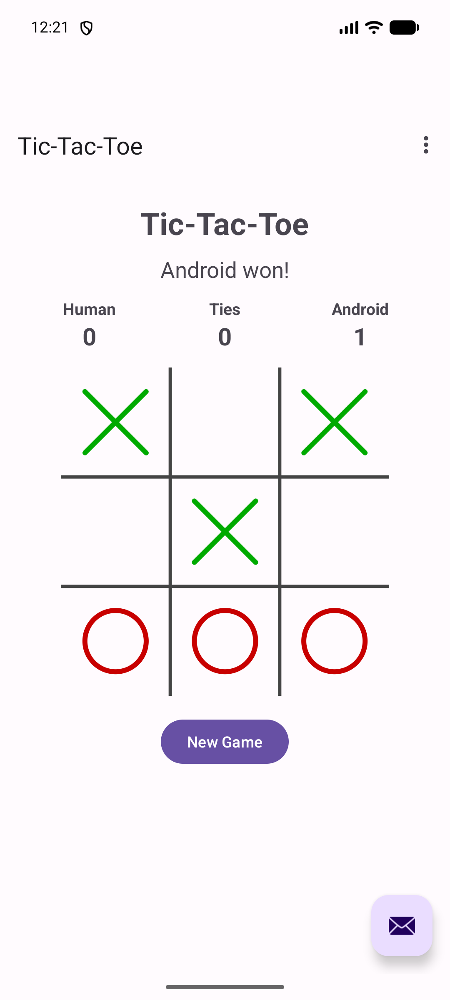
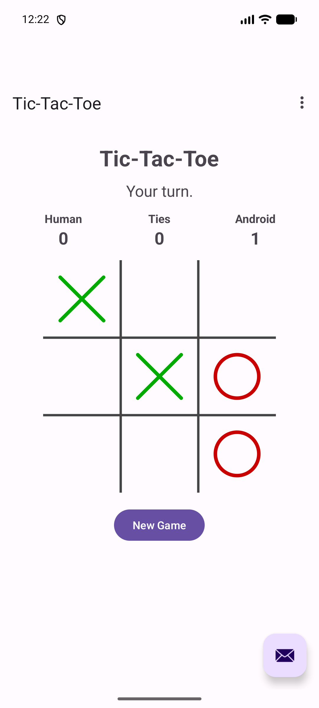
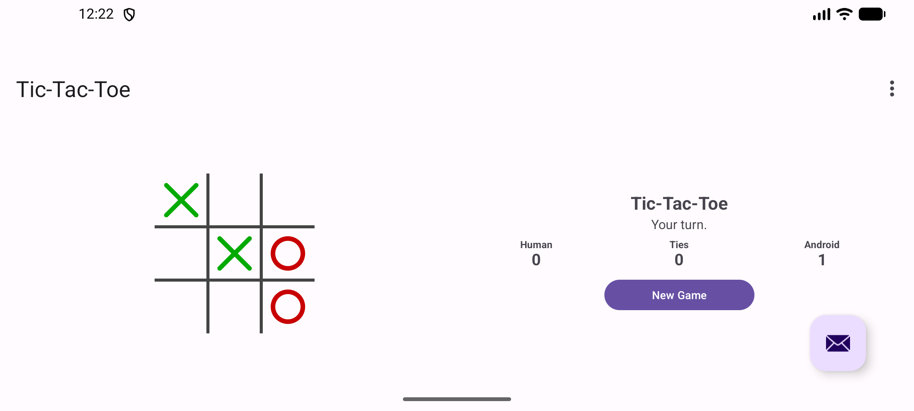
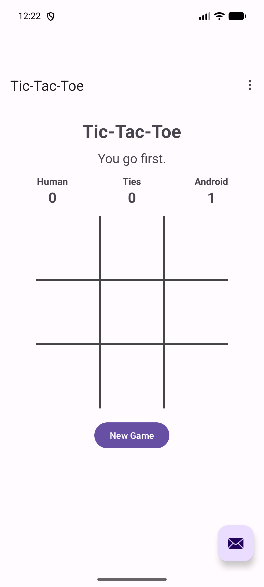
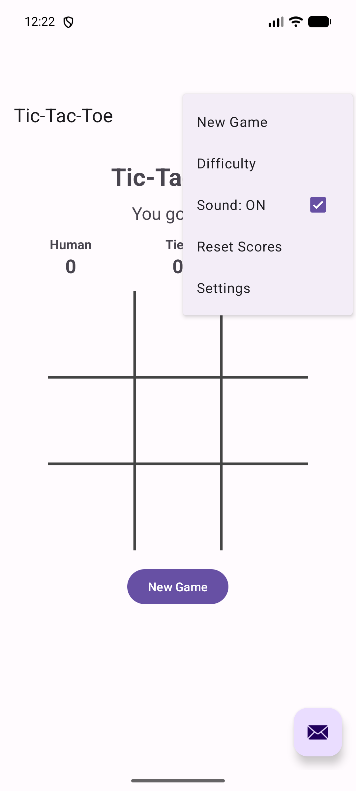

# ❌⭕ Manual de Usuario y Técnico — Reto 6: Saving Instance State and Persistent Information

> **Curso:** Desarrollo de Aplicaciones para Dispositivos Móviles
> **Autor y desarrollador:** Luis Alberto Castillo Sanabria
> **Institución:** Universidad Nacional de Colombia
> **Plataforma:** Android · Kotlin · SharedPreferences · onSaveInstanceState

---

## 📑 Tabla de contenidos

1. [Propósito](#1-propósito)
2. [Autoría](#2-autoría)
3. [Manual de uso](#3-manual-de-uso)
4. [Dos tipos de memoria: estado temporal y persistente](#4-dos-tipos-de-memoria-estado-temporal-y-persistente)
5. [Arquitectura y código](#5-arquitectura-y-código)
6. [Compilación y ejecución](#6-compilación-y-ejecución)

---

## 1. Propósito

En Android, **girar la pantalla destruye y vuelve a crear la actividad**. Sin cuidado, eso borra la partida. Y al **cerrar la app** se pierde todo lo que estaba en memoria. Este reto resuelve ambos problemas:

- **Estado temporal** (la partida en curso) → `onSaveInstanceState` y `Bundle`.
- **Información persistente** (marcador y dificultad) → `SharedPreferences`.

## 2. Autoría

| Integrante | Rol |
|:---|:---|
| **Luis Alberto Castillo Sanabria** | Autor y desarrollador |

Curso *Desarrollo de Aplicaciones para Dispositivos Móviles* — **Universidad Nacional de Colombia**.
Repositorio: <https://github.com/LCastillo9806/AndroidTicTacToe-Reto6>

## 3. Manual de uso

### 3.1 Pantalla inicial y marcador

Debajo del mensaje de estado aparece el **marcador**: **Human** (tus victorias), **Ties** (empates) y **Android** (victorias del computador).

| Pantalla inicial |
|:---:|
|  |

### 3.2 Jugar y sumar puntos

Toca una casilla libre para poner tu **X**; Android responde con una **O** al cabo de un segundo. Al terminar la partida, el marcador suma un punto al ganador o al empate.

| Android ganó: su marcador sube a 1 |
|:---:|
|  |

### 3.3 Girar la pantalla sin perder la partida

1. Empieza una partida nueva con **New Game** y haz algunas jugadas.
2. Gira el teléfono a horizontal.
3. La app cambia a su **diseño horizontal** y el tablero, el turno y el marcador siguen exactamente igual.

| Partida en curso (vertical) | La misma partida (horizontal) |
|:---:|:---:|
|  |  |

### 3.4 Cerrar y volver a abrir la app

Cierra la app por completo y ábrela de nuevo: el **marcador se conserva**, igual que la dificultad elegida.

| Al reabrir, Android sigue con 1 victoria |
|:---:|
|  |

### 3.5 Menú de opciones

| Opción | Acción |
|---|---|
| **New Game** | Reinicia el tablero (el marcador no cambia) |
| **Difficulty** | Easy, Harder o Expert; la elección se guarda |
| **Sound: ON / OFF** | Activa o silencia los efectos |
| **Reset Scores** | Pone el marcador en 0 – 0 – 0 y lo guarda |

| Menú de opciones |
|:---:|
|  |

## 4. Dos tipos de memoria: estado temporal y persistente

### 4.1 Estado temporal — `onSaveInstanceState`

Antes de que Android destruya la pantalla al rotar, el fragmento guarda en un `Bundle`:

| Clave | Contenido |
|---|---|
| `board_state` | Las 9 casillas del tablero |
| `current_player` | De quién es el turno |
| `game_over` | Si la partida ya terminó |
| `computer_thinking` | Si Android estaba a punto de jugar |
| `difficulty` | Nivel actual |
| `sound_enabled` | Sonido activado o no |
| `score_counted` | Evita sumar dos veces el mismo resultado al rotar |

Al recrearse, `restoreGameState()` lee el `Bundle`, vuelve a dibujar el tablero y, si Android estaba pensando, retoma su jugada.

### 4.2 Información persistente — `SharedPreferences`

El archivo de preferencias `tic_tac_toe_preferences` guarda:

| Clave | Contenido |
|---|---|
| `human_wins` | Victorias del jugador |
| `computer_wins` | Victorias de Android |
| `ties` | Empates |
| `difficulty_level` | Último nivel de dificultad elegido |

```kotlin
private fun saveScores() {
    requireContext()
        .getSharedPreferences(PREFS_NAME, Context.MODE_PRIVATE)
        .edit()
        .putInt(PREF_HUMAN_WINS, humanWins)
        .putInt(PREF_COMPUTER_WINS, computerWins)
        .putInt(PREF_TIES, ties)
        .apply()
}
```

*(Fragmento resumido de `FirstFragment.kt`.)*

## 5. Arquitectura y código

```
FirstFragment
 ├─ onSaveInstanceState(Bundle)  ── guarda la partida al rotar
 ├─ restoreGameState(Bundle)     ── la recupera
 ├─ SharedPreferences            ── marcador + dificultad (permanentes)
 ├─ BoardView (Canvas)           ── tablero
 ├─ TicTacToeGame                ── lógica e IA
 └─ layout/ y layout-land/       ── diseño vertical y horizontal
```

| Archivo | Función |
|---|---|
| `app/src/main/java/co/edu/unal/tictactoe/FirstFragment.kt` | Juego, guardado/restauración del estado, marcador y menú |
| `app/src/main/java/co/edu/unal/tictactoe/TicTacToeGame.kt` | Lógica, IA y métodos para exportar/importar el tablero |
| `app/src/main/java/co/edu/unal/tictactoe/BoardView.kt` | Tablero dibujado con Canvas |
| `app/src/main/res/layout/fragment_first.xml` | Diseño vertical con marcador |
| `app/src/main/res/layout-land/fragment_first.xml` | Diseño horizontal |
| `app/src/main/res/menu/options_menu.xml` | Opciones del menú (incluye Reset Scores) |

## 6. Compilación y ejecución

```bash
git clone https://github.com/LCastillo9806/AndroidTicTacToe-Reto6.git
cd AndroidTicTacToe-Reto6
./gradlew installDebug
```

Para probar la rotación en el emulador usa los botones de girar de la barra lateral; en un teléfono, activa la rotación automática.

---
*Luis Alberto Castillo Sanabria — Universidad Nacional de Colombia*
